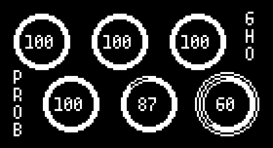
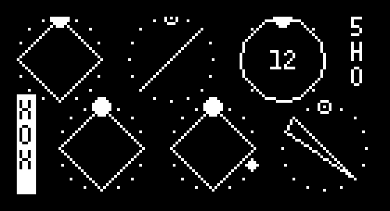
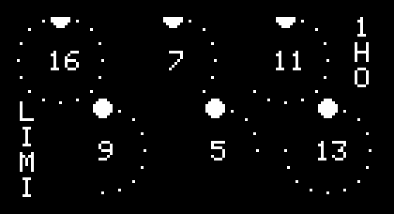
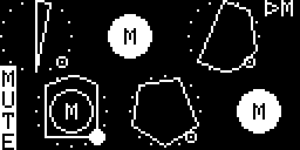
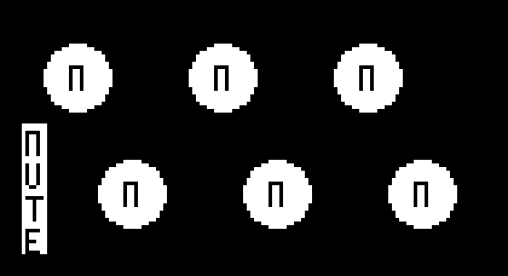

# EUCLID + XOX — A-RYTH-MATIK firmware


EUCLID + XOX is a firmware for the 6 channel euclidean trigger sequencer designed by [HAGIWO](https://www.youtube.com/@HAGIWO). It redesigns the interface and the functions around simple live use:

- each channel can be programmed step by step (XOX) or with the euclidean formula, and both modes can be mixed;
- the working state is saved by itself and comes back at power-up;
- channels are muted from a dedicated mode, and a global cut restores the previous mix;
- the screen shows the state of each channel with a few consistent signs (rings, stickers, numbers, donuts);
- 9 presets in the memory slots go from simple to complex and show how the module works.

It runs on the [Modulove A-RYTH-MATIK](https://github.com/modulove/A-RYTH-MATIK) (Arduino Nano / ATmega328P, SSD1306 OLED). It was tested on a Modulove A-RYTH-MATIK and is based on the latest version of the Euclid firmware in the Modulove repository.

This is an unofficial firmware. It is not made or supported by Modulove or HAGIWO; please send questions about it here.

**Credits**
- **HAGIWO** created the sequencer: the circuit, the idea of showing each channel as a ring on the OLED, and most of the original firmware.
- **[Modulove](https://github.com/modulove) & friends** improved the hardware considerably (protected inputs and outputs, reset input, status LEDs, presoldered SMD kits) and extended HAGIWO's firmware into the Euclid firmware.
- **Joaquín Contreras** redesigned the interface and the functions in this version, made the presets and drew the splash. The digits on screen use JARA, his pixel font.

The screenshots below are rendered from the firmware's own drawing code, at 4× size.

## Quick guide

### Main menu
Turn the encoder to move through the menu on the right column: channels **1–6**, **RND**, **X**, **S**, **L**, **T**, **R** and **M**.

### Channel menu
On a channel, a click moves to the next setting: **HITS → OFFS → LIMI → RESET → RANDOM → PROB → XOX**, then back to the top. A long click goes back one setting. Turning changes the value of the selected setting.

- Pressing and turning the encoder on a channel at the top level changes its HITS directly.
- A long click on a channel at the top level mutes or unmutes it.
- When the left column is empty, it shows the current BPM, written vertically.

### Probability (PROB)
PROB is the setting before XOX. Each channel shows its probability as a donut that fills clockwise from the top, with the number in the hole. A full donut is 100 %. The selected channel has a thin outer ring; press and turn to change channel.



### XOX (step programming)
XOX is the last setting of the channel menu.



- Turn to move the cursor, a filled diamond, through the steps up to the LIMI length.
- Click to turn the step under the cursor on or off. The diamond blinks when the step is on.
- Long click to leave XOX.

The first edit switches the channel to XOX and starts from the euclidean pattern that was playing. OFFS rotates the drawn pattern. Changing HITS, or a random change of the hits, returns the channel to euclidean mode; HITS starts from the number of active steps of the drawing.

### Ring numbers



- In LIMI, each ring shows its number of steps at the center instead of the polygon.
- With more than 8 hits, the ring shows the number of hits at the center. In XOX it counts the active steps.

### Mute (M)

 

- Click on **M** to enter mute mode. The MUTE label on the left turns inverted (white strip, black letters). Turn to choose a channel and click to mute or unmute it. Long click to leave: the mutes stay as they are and the cursor jumps to channel 1.
- Hold the encoder on **M**, outside mute mode, for a global cut:
  - after 0.4 s all channels are muted, and the ones that were just muted blink for 2 seconds;
  - holding to 2 s makes all stickers blink;
  - holding to 4 s unmutes all channels.
- While the cut is active, holding the encoder on **M** again for 0.4 s restores the previous mutes. Changing a mute by hand in the meantime clears the stored mix, and the next hold mutes all again.
- A muted channel is drawn as a white circle with a black M.

### Memory

 

- **Working state:** the current state is saved automatically 10 seconds after the last encoder action, and it comes back at power-up. It is written one byte per loop pass, so playback keeps running while it saves.
- **S / L:** click to open, turn to choose one of 20 slots, long click to save or load.
- Next to the slot number, a filled circle means the slot has something saved; an outlined circle means it still has the initial rhythm (4 hits in 16 steps on every channel). In S, the bottom line reads "long PRESS Overwrite" when the slot has something saved.
- While you hold the encoder in S or L, a line fills under the text. When it is full, releasing saves or loads; releasing earlier does nothing.
- **Names:** each slot has a 3-letter name. After saving with a long click, the name opens for editing: turn to change the letter (space, A–Z, 0–9, -), click to go to the next one. A click after the third letter, or a long click at any time, closes it.
- Slots use a compact 41-byte format that includes the XOX patterns. Slots from the previous Euclid format are converted automatically at the first boot.

### Presets
The 20 factory presets of the original firmware and the P menu were removed. Instead, 9 presets are written once into slots 1 to 9. They load and can be overwritten like any other slot. They go from simple to complex, and each one shows something about the module.


All presets follow the same channel order, so one patch works with all of them:

| Channel | Role |
|---|---|
| 1 | Kick |
| 2 | Snare or clap |
| 3 | Closed hi-hat |
| 4 | Open hi-hat or cymbal |
| 5 | Percussion (conga, tom, bell) |
| 6 | Percussion, accent or a melodic sound |

| Slot | Name | Tempo | Mode | Content |
|---|---|---|---|---|
| 1 | EUC | 120 | eucli | **HITS:** 2, 3, 4, 5, 6 and 7 hits in 16 steps. The rings show a line, a triangle, a square, a pentagon, a hexagon and a heptagon. Turn HITS to hear and see the change. |
| 2 | BOS | 120 | eucli | **OFFS:** the bossa nova clave (5 in 16) and the samba pattern (7 in 16) are euclidean rhythms rotated with OFFS. |
| 3 | CUB | 100 | eucli | Traditional rhythms that are euclidean: tresillo (6 in 16, OFFS 5) and cinquillo (10 in 16, OFFS 3). |
| 4 | DEM | 95 | XOX | Dembow, drawn step by step. |
| 5 | CMB | 95 | XOX + eucli | Classic Colombian cumbia: kick, llamador and cowbell in eucli mode; maracas, güiro and bass drawn in XOX. |
| 6 | BRK | 132 | XOX + eucli | Breakbeat: kick, snare, hi-hat and open hi-hat drawn in XOX; a tom (5 hits, 87 %) and a pluck (9 hits, 60 %) in eucli mode with probability, so both modes work together. |
| 7 | TER | 90 | XOX | **LIMI:** all channels in 12 steps, a triple pulse with a bembé bell (7 in 12) on channel 5. |
| 8 | POL | 120 | XOX | Polymeter: each channel has a different length (16, 7, 11, 9, 5, 13 steps), and channels 3 to 6 have probability, so the patterns drift apart and change over time. |
| 9 | DIV | 120 | eucli | Clock divider, a utility: 16, 8, 4, 2 and 1 hits, and channel 6 with 4 hits on the offbeats. |

The ring always draws 16 positions. A channel with LIMI below 16 uses only part of the circle, so in TER and POL the shapes look uneven while the rhythms are exact.

In eucli mode the formula always works on 16 steps, and LIMI cuts the pattern. 3 hits with LIMI 8 is the first half of 3 in 16, so it does not give a tresillo. To get an exact euclidean rhythm of another length, draw it in XOX, as in TER and POL.

The euclidean examples are based on Godfried Toussaint, "The Euclidean Algorithm Generates Traditional Musical Rhythms" (2005).

- On a new Nano, the presets fill slots 1 to 9.
- When updating from the original Euclid, a slot is replaced only if it is still at the initial rhythm or holds the unchanged factory preset the old firmware stored there. Slots with your own rhythms are kept.
- Loading a preset sets its tempo but does not switch between internal and external clock.

### Clock
- **T:** click to see the tempo, turn to change it (40–240 BPM). Long click switches between internal and external clock.
- With an external clock, the BPM is measured in microseconds and averaged over about 4 pulses, so the reading stays steady.

## Changes from the original Euclid firmware

**Sequencing**
- XOX step programming mode per channel.
- MUTE was removed from the channel settings; channels are muted from mute mode or with a long click on the channel.
- Mute mode on M, and a global cut that restores the previous mutes. The full-screen MUTE view was removed.

**Memory**
- Autosaved working state, written without stopping playback.
- Compact slot format (`EUCLID11`) with XOX patterns and automatic migration from `EUCLID10`.
- The 20 factory presets and the P menu were replaced by 9 presets stored in the slots, with a fixed channel order (see Presets).
- 3-letter slot names, a saved/empty indicator, and an overwrite notice in S.

**Display**
- EUCLID + XOX splash.
- PROB shows each channel's probability as a donut, with a ring on the selected channel.
- Step and hit numbers at the center of the rings.
- BPM in the empty left column.
- Numbers drawn with the JARA pixel font (`JaraNumeros.h`, digits only). Text and menu letters use the system font.
- SAVE, LOAD and TEMPO screens left-aligned with more line spacing.
- Removed the small animated pixel noise in the lower right corner. It came from the stack reaching the display buffer; RAM use was reduced to fix it.

**Clock and LEDs**
- Steadier external BPM reading.
- Dimmer LEDs: the LED flash lasts 5 ms and the screen redraws after it. Output triggers keep their original length (about 30 ms).
- If your encoder turns the wrong way, use the `_reversed` hex file, or compile with `-DENCODER_REVERSED`.

**Fixes**
- RND cycles through 2, 4, 6, 8, 12 and 16 bars. The original never reached 2 and read outside the table after 16.
- With LIMI above 16, the extra steps repeat the pattern instead of reading the next channel's data.
- A channel with a single active step (euclidean or XOX) draws a line from the center of the ring to that step.
- Steps are stored as 16-bit masks per channel and polygons are drawn without a point buffer, which frees RAM.

## Flashing the hex file

The `hex/` folder has two ready-made files: `EucliXOX_normal.hex` and `EucliXOX_reversed.hex` (for modules whose encoder turns the other way). They can be flashed with avrdude, which comes with the Arduino IDE:

```bash
avrdude -p atmega328p -c arduino -P <port> -b 115200 -U flash:w:EucliXOX_normal.hex:i
```

Nanos with the old bootloader use `-b 57600`. Flash the module with only the USB cable connected, without Eurorack power.

At the first boot, slots saved with the original Euclid firmware are converted to the new format, and the presets are written into slots 1 to 9 where they are still empty or hold the unchanged factory presets. Slots with your own rhythms are kept. To be safe, back up your EEPROM before flashing: `avrdude ... -U eeprom:r:backup.hex:i`.

## Building

Requires the Arduino AVR core and the libraries FastGPIO, Adafruit GFX, Adafruit SSD1306 and EncoderButton.

The firmware must be compiled with `-DSSD1306_NO_SPLASH`. This flag removes the Adafruit logo that the SSD1306 library stores in flash (about 1.2 KB). The logo is never shown in this firmware, and without the flag the firmware does not fit in the Nano. The Arduino IDE has no simple way to pass the flag, so use `arduino-cli`:

```bash
arduino-cli compile -b arduino:avr:nano --build-property "build.extra_flags=-DSSD1306_NO_SPLASH" EucliXOX
arduino-cli upload  -b arduino:avr:nano -p <port> EucliXOX
```

Add `-DENCODER_REVERSED` to the flags for a reversed encoder. Nanos with the old bootloader use `-b arduino:avr:nano:cpu=atmega328old`. With the flag, the firmware uses 30636 of the 30720 bytes available with the old bootloader.

## License

MIT, as the original firmware. See `LICENSE`.
