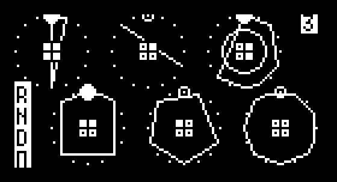
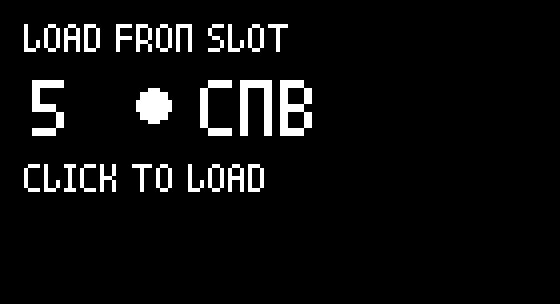
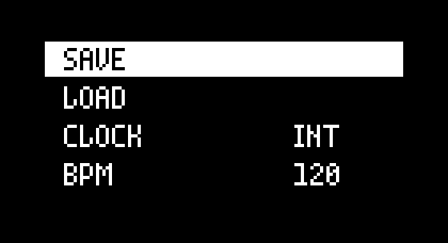
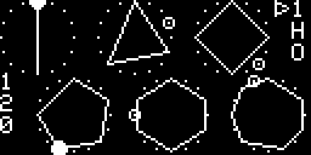

# EUCLID + XOX — A-RYTH-MATIK firmware


Made by Joaquín Contreras (Oficina de Sonido).

EUCLID + XOX is a firmware for the 6 channel euclidean trigger sequencer designed by [HAGIWO](https://www.youtube.com/@HAGIWO). It redesigns the interface and the functions around simple live use:

- each channel can be programmed step by step (XOX) or with the euclidean formula, and both modes can be mixed;
- the working state is saved by itself and comes back at power-up;
- each channel can play only in some bars of a 4 bar cycle (COND), so channels can take turns;
- each channel can change its rhythm at random in the bars you choose of a 4 bar cycle (RNDM);
- channels are muted from a dedicated mode, and a global cut restores the previous mix;
- one cyclic chain of items: click goes forward, double click goes back, and long click opens the items that are marked as closed (XOX, RNDM, MUTE, SYST);
- the screen shows the state of each channel with a few consistent signs (rings, stickers, numbers, donuts);
- 9 presets in the memory slots go from simple to complex and show how the module works.

It runs on the [Modulove A-RYTH-MATIK](https://github.com/modulove/A-RYTH-MATIK) (Arduino Nano / ATmega328P, SSD1306 OLED). It was tested on a Modulove A-RYTH-MATIK and is based on the latest version of the Euclid firmware in the Modulove repository.

This is an unofficial firmware. It is not made or supported by Modulove or HAGIWO; please send questions about it here.

## Credits: what comes from where

**[HAGIWO](https://www.youtube.com/@HAGIWO)** created the sequencer ([article and original code](https://note.com/solder_state/n/n433b32ea6dbc)). The architecture of the firmware comes from his version:
- the circuit and the 6 channel layout on a 128×64 OLED;
- each channel drawn as a ring of 16 steps, with lines joining the hits into a shape, and a line from the center when there is a single hit;
- the precomputed euclidean table for 16 steps, and the ring and layout tables;
- the HIT, OFFSET, LIMIT, MUTE and RESET settings, and a random mode.

**[Modulove](https://github.com/modulove) & friends** made the A-RYTH-MATIK module and the Euclid firmware this version is based on:
- hardware: protected inputs and outputs, a reset input, status LEDs per output and for the clock, presoldered SMD kits, and a panel by bkrsmdesign;
- probability per channel (PROB), random per channel (removed in this version), internal clock with tempo, and external BPM display;
- 20 save and load slots in EEPROM, and 20 factory presets;
- the RND auto advance over 2 to 16 bars, and the X random change (both replaced in this version by the RNDM mode);
- encoder handling with press and turn, long clicks and acceleration, the all-reset and all-mute menus, and options for LGT8FX boards, a rotated panel and a reversed encoder.

**Joaquín Contreras** redesigned the interface and the functions in this version:
- XOX step programming per channel, combinable with the euclidean mode;
- COND, which chooses in which bars of a 4 bar cycle each channel plays;
- RNDM, which chooses in which bars of a 4 bar cycle each channel changes its rhythm at random;
- the navigation: one cyclic chain with click, double click and long click, the cursor drawn as an inverted letter, and the SYST list for save, load, clock and tempo;
- the autosaved working state;
- mute mode with stickers, and the global cut that restores the previous mix;
- 3-letter slot names, the saved/empty indicator and the overwrite notice;
- 9 presets ordered for learning, with a fixed channel order, written into the slots (the factory presets and the P menu were removed);
- numbers at the center of the rings, BPM in the left column, probability donuts, and the splash;
- fixes: LIMI above 16, the pixel noise from the stack reaching the display buffer, a steady external BPM reading, and shorter LED flashes.

The screenshots below are rendered from the firmware's own drawing code, at 4× size.

## Quick guide

### How the menu works
The module has one encoder: a knob that you can turn, press (click) and press while turning. A double click and a long click (holding for 0.3 s) are also used.

All the items are in one cyclic chain. A **click** goes to the next item and a **double click** goes to the previous one. After the last item it comes back to the first, and the other way round.

| Gesture | What it does |
|---|---|
| **Turn** | Changes the number of the item you are on (on the first item, the channel). On the items from XOX on there is no number, and turning does nothing. |
| **Press and turn** | Changes channel, on any item. |
| **Click** | Next item. |
| **Double click** | Previous item. |
| **Long click** | Opens a closed item, runs RSET, and closes the mode that is open. |

#### The chain
The right column of the screen shows the selected channel as **1HO** … **6HO**: the number, then H (hits) and O (offset). On the first three items, the letter you are on is drawn inverted (white box, black letter). From LIMI on there is no initial to mark, and the name of the item is on the left.

| Item | Left column | Turning |
|---|---|---|
| **CH**, the channel (number inverted) | the BPM, written vertically | changes the channel |
| **HITS** (H inverted) | HITS | changes the hits of the channel |
| **OFFS** (O inverted) | OFFS | rotates the pattern |
| **LIMI** | LIMI | changes the number of steps |
| **RESET** | RESET | sends the channel back to its first step |
| **PROB** | PROB | changes the probability of the channel, see PROB |
| **COND** | COND | goes through the 16 combinations of bars, see COND |
| **XOX** (closed) | XOX | nothing |
| **RNDM** (closed) | RNDM | nothing |
| **MUTE** (closed) | MUTE | nothing |
| **RSET** (closed) | RSET | nothing |
| **SYST** (closed) | SYST | nothing |

From XOX on there is no number to change. Turning does nothing there, and the chain is moved only with clicks and double clicks. To change the channel on those items, press and turn.

#### Closed items
The items that open with a long click have their name inverted on the left (white strip, black letters). RSET is also drawn inverted: a long click runs the reset of all channels and stays in the chain.

| Item | Long click opens | Inside the mode |
|---|---|---|
| **XOX** | step programming of the selected channel | turn moves the cursor, click toggles the step, press and turn changes channel |
| **RNDM** | timed random | turn goes through the 16 combinations of the channel, press and turn changes channel |
| **MUTE** | mute mode | turn chooses a channel, click mutes or unmutes it, press and turn makes the global cut |
| **SYST** | system list: SAVE, LOAD, CLOCK, BPM | turn chooses the entry, click opens it |

Inside any mode a long click leaves it and the cursor stays on that item. While a mode is open, a click answers at once. In the chain, a click waits 220 ms to tell whether it is a double click (`MULTI_CLICK_MS` in the source).

### Probability (PROB)
Each channel shows its probability as a donut that fills clockwise from the top, with the number in the hole. A full donut is 100 %. The selected channel has a thin outer ring; press and turn to change channel.


### COND (which bars play)
COND sets in which bars of a 4 bar cycle a channel plays. A bar is 16 clocks, one turn of the ring, and the cycle repeats every 4 bars. Each channel shows a small square divided in 4 (7 px) as a sticker at the center of its ring, so the rhythm stays visible behind it. The quarters follow the reading order (top left bar 1, top right bar 2, bottom left bar 3, bottom right bar 4). A filled quarter plays in that bar and an empty quarter is only outlined. The selected channel has a thin ring around its sticker.


Turn to go through the 16 combinations, ordered by number of filled quarters: 0000 (never), X000, 0X00, 00X0, 000X, XX00, 0XX0, 00XX, X0X0, 0X0X, X00X, XXX0, 0XXX, XX0X, X0XX, XXXX (every bar, the default). X0X0 and 0X0X make a channel play every other bar, so two channels can take turns. The pattern of the channel (HITS, OFFS, LIMI or XOX) is the same in every bar; COND only decides whether it sounds. RESET restarts the count at bar 1. It is saved in the memory slots and in the autosave; slots saved before COND read as XXXX.

### XOX (step programming)
XOX is a closed item: a long click opens it on the selected channel.


- Turn to move the cursor, a filled diamond, through the steps up to the LIMI length.
- Click to turn the step under the cursor on or off. The diamond blinks when the step is on.
- Press and turn to change channel. A long click leaves XOX and the cursor stays on the XOX item.

The first edit switches the channel to XOX and starts from the euclidean pattern that was playing. OFFS rotates the drawn pattern. Changing HITS, or a random change of the hits, returns the channel to euclidean mode; HITS starts from the number of active steps of the drawing.

### Ring numbers


- In LIMI, each ring shows its number of steps at the center instead of the polygon.
- From 5 hits on, the ring shows the number of hits at the center, over the shape. In XOX it counts the active steps.

### RNDM (timed random)



- RNDM shows the same small square as COND, as a sticker at the center of each ring, with one quarter per bar of the 4 bar cycle. A filled quarter means that the channel changes its hits and offset at random at the start of that bar. An empty quarter means no change in that bar.
- Go to **RNDM** in the chain to see the squares. A long click opens the mode: the channel of the cursor gets a thin ring around its sticker and its number appears inverted in the right column.
- Inside the mode, turn to go through the 16 combinations of the channel, from 0000 (never) to XXXX (every bar), in the same order as COND. Press and turn to change channel. A long click leaves the mode.
- Examples: X000 changes the channel once every 4 bars, X0X0 in bars 1 and 3, XXXX in every bar.
- The default is 0000 on every channel. The combinations stay active while you work on other items. They are saved in the memory slots and in the autosave, like COND: at power-up they come back as they were, and a slot saved before RNDM existed reads as 0000 on every channel.
- The change needs the clock to run (internal or external), since bars are counted with the clock pulses.
- The random changes do not touch the mutes. A channel that was muted stays muted.

### Mute (MUTE)

 

- Go to **MUTE** in the chain and open it with a long click. Turn to choose a channel and click to mute or unmute it. A long click leaves: the mutes stay as they are.
- **Global cut**, inside the mode with press and turn: to the right it mutes all channels and remembers the previous mix. To the left it restores that mix. If there is no stored mix, to the left it unmutes all channels.
- Changing a mute by hand clears the stored mix.
- A muted channel is drawn as a white circle with a black M.

### Memory

 

- **Working state:** the current state is saved automatically 10 seconds after the last encoder action, and it comes back at power-up. It is written one byte per loop pass, so playback keeps running while it saves.
- **SAVE and LOAD** are entries of **SYST**. Open SYST with a long click, turn to choose SAVE or LOAD and click to open it. Turn to choose one of 20 slots and click again to confirm: it saves or loads. A long click leaves without confirming.



- Next to the slot number, a filled circle means the slot has something saved; an outlined circle means it still has the initial rhythm (4 hits in 16 steps on every channel). In SAVE, the bottom line reads "CLICK TO OVERWRITE" when the slot has something saved.
- **Names:** each slot has a 3-letter name. After saving, the name opens for editing: turn to change the letter (space, A–Z, 0–9, -), click to go to the next one. A click after the third letter, or a long click at any time, closes it.
- Slots use a compact 41-byte format that includes the XOX patterns. Slots saved by the original Euclid firmware are not converted: on a module coming from it, the first boot starts with empty slots.

### Presets
The 20 factory presets of the original firmware and the P menu were removed. Instead, 9 presets are written once into slots 1 to 9. They load and can be overwritten like any other slot. They go from simple to complex, and each one shows something about the module.



All presets follow the same channel order, so one patch works with all of them:

| Channel | Role |
|---|---|
| 1 | Kick |
| 2 | Snare or clap |
| 3 | Closed hi-hat |
| 4 | Open hi-hat or cymbal |
| 5 | Percussion (conga, tom, bell) |
| 6 | Percussion, accent or a melodic sound |

| Slot | Name | Tempo | Mode | Content |
|---|---|---|---|---|
| 1 | EUC | 120 | eucli | **HITS:** 2, 3, 4, 5, 6 and 7 hits in 16 steps. The rings show a line, a triangle, a square, a pentagon, a hexagon and a heptagon. Turn HITS to hear and see the change. |
| 2 | BOS | 120 | eucli | **OFFS:** the bossa nova clave (5 in 16) and the samba pattern (7 in 16) are euclidean rhythms rotated with OFFS. |
| 3 | CUB | 100 | eucli | Traditional rhythms that are euclidean: tresillo (6 in 16, OFFS 5) and cinquillo (10 in 16, OFFS 3). |
| 4 | DEM | 95 | XOX | Dembow, drawn step by step. |
| 5 | CMB | 95 | XOX + eucli | Classic Colombian cumbia: kick, llamador and cowbell in eucli mode; maracas, güiro and bass drawn in XOX. |
| 6 | BRK | 132 | XOX + eucli | Breakbeat: kick, snare, hi-hat and open hi-hat drawn in XOX; a tom (5 hits, 87 %) and a pluck (9 hits, 60 %) in eucli mode with probability, so both modes work together. |
| 7 | TER | 90 | XOX | **LIMI:** all channels in 12 steps, a triple pulse with a bembé bell (7 in 12) on channel 5. |
| 8 | POL | 120 | XOX | Polymeter: each channel has a different length (16, 7, 11, 9, 5, 13 steps), and channels 3 to 6 have probability, so the patterns drift apart and change over time. |
| 9 | DIV | 120 | eucli | Clock divider, a utility: 16, 8, 4, 2 and 1 hits, and channel 6 with 4 hits on the offbeats. |

The ring always draws 16 positions. A channel with LIMI below 16 uses only part of the circle, so in TER and POL the shapes look uneven while the rhythms are exact.

In eucli mode the formula always works on 16 steps, and LIMI cuts the pattern. 3 hits with LIMI 8 is the first half of 3 in 16, so it does not give a tresillo. To get an exact euclidean rhythm of another length, draw it in XOX, as in TER and POL.

The euclidean examples are based on Godfried Toussaint, "The Euclidean Algorithm Generates Traditional Musical Rhythms" (2005).

- On a new Nano, the presets fill slots 1 to 9.
- The presets are written only into slots that hold the initial rhythm. Slots with your own rhythms are kept.
- Loading a preset sets its tempo but does not switch between internal and external clock.

### Clock
- **CLOCK** and **BPM** are entries of **SYST**. In CLOCK, turn to switch between INT (internal clock) and EXT (external clock) and click to close. In BPM, turn to change the tempo (40–240 BPM) and click to close. With the external clock, BPM shows the measured tempo.
- With an external clock, the BPM is measured in microseconds and averaged over about 4 pulses, so the reading stays steady.

## Changes from the original Euclid firmware

**Sequencing**
- XOX step programming mode per channel.
- COND: each channel plays in the bars of a 4 bar cycle that you choose (16 combinations).
- RNDM: each channel changes its hits and offset at random in the bars of a 4 bar cycle that you choose (16 combinations, as COND). It replaces the original RND (auto advance over 2 to 16 bars, all channels) and X (random change of all channels) items.
- MUTE was removed from the channel settings; channels are muted only from mute mode (MUTE).
- Mute mode, and a global cut inside it that restores the previous mutes. The full-screen MUTE view was removed.

**Memory**
- Autosaved working state, written without stopping playback.
- Compact slot format (`EUCLID11`) with XOX patterns (slots from the original `EUCLID10` format are not converted).
- The 20 factory presets and the P menu were replaced by 9 presets stored in the slots, with a fixed channel order (see Presets).
- 3-letter slot names, a saved/empty indicator, and an overwrite notice in SAVE.

**Interface**
- The screen uses a custom 4x7 pixel uppercase font (`EucliXOX/Font4x7.h`, source font in `fonts/OLED4x7-Regular.ttf`), so all texts are uppercase.
- One cyclic chain of items: click goes to the next, double click to the previous, and long click opens the items marked as closed (XOX, RNDM, MUTE, SYST) or runs RSET. The original menus (a main menu with channels, RND, X, S, L, T, R and M, and a channel menu) were replaced.
- Turning changes the number of the item. Press and turn changes channel on any item.
- SYST groups SAVE, LOAD, CLOCK and BPM. SAVE and LOAD confirm with a click instead of holding the encoder.
- The cursor is an inverted letter in the right column (the channel number, H or O). Closed items have their name inverted on the left.

**Display**
- EUCLID + XOX splash.
- PROB shows each channel's probability as a donut, with a ring on the selected channel.
- COND shows each channel's bars as a small square divided in 4, as a sticker on the ring.
- Step and hit numbers at the center of the rings.
- BPM in the left column while the chain is on CH.
- SAVE, LOAD, CLOCK and BPM screens left-aligned with more line spacing.
- Removed the small animated pixel noise in the lower right corner. It came from the stack reaching the display buffer; RAM use was reduced to fix it.

**Clock and LEDs**
- Steadier external BPM reading.
- Dimmer LEDs: the LED flash lasts 5 ms and the screen redraws after it. Output triggers keep their original length (about 30 ms).
- If your encoder turns the wrong way, use the `_reversed` hex file, or compile with `-DENCODER_REVERSED`.

**Fixes**
- The random functions no longer change the mutes (the original unmuted the channel on each random change). The RANDOM setting of each channel was removed: random is only in RNDM.
- With LIMI above 16, the extra steps repeat the pattern instead of reading the next channel's data.
- A channel with a single active step (euclidean or XOX) draws a line from the center of the ring to that step.
- Steps are stored as 16-bit masks per channel and polygons are drawn without a point buffer, which frees RAM.

## Flashing the hex file

The `hex/` folder has two ready-made files: `EucliXOX_normal.hex` and `EucliXOX_reversed.hex` (for modules whose encoder turns the other way). They can be flashed with avrdude, which comes with the Arduino IDE:

```bash
avrdude -p atmega328p -c arduino -P <port> -b 115200 -U flash:w:EucliXOX_normal.hex:i
```

Nanos with the old bootloader use `-b 57600`. Flash the module with only the USB cable connected, without Eurorack power.

At the first boot on a module that ran the original Euclid firmware, the slots start empty (they are not converted) and the presets are written into slots 1 to 9. To be safe, back up your EEPROM before flashing: `avrdude ... -U eeprom:r:backup.hex:i`.

## Building

Requires the Arduino AVR core and the libraries FastGPIO, Adafruit GFX, Adafruit SSD1306 and EncoderButton.

The firmware must be compiled with `-DSSD1306_NO_SPLASH`. This flag removes the Adafruit logo that the SSD1306 library stores in flash (about 1.2 KB). The logo is never shown in this firmware, and without the flag the firmware does not fit in the Nano. The Arduino IDE has no simple way to pass the flag, so use `arduino-cli`:

```bash
arduino-cli compile -b arduino:avr:nano --build-property "build.extra_flags=-DSSD1306_NO_SPLASH" EucliXOX
arduino-cli upload  -b arduino:avr:nano -p <port> EucliXOX
```

Add `-DENCODER_REVERSED` to the flags for a reversed encoder. Nanos with the old bootloader use `-b arduino:avr:nano:cpu=atmega328old`. With the flag, the firmware uses 30502 of the 30720 bytes available with the old bootloader.

## License

MIT, as the original firmware. See `LICENSE`.
