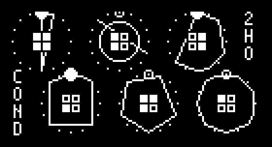

# EUCLID + XOX — A-RYTH-MATIK firmware


Made by Joaquín Contreras (Oficina de Sonido).

EUCLID + XOX is a firmware for the 6 channel euclidean trigger sequencer designed by [HAGIWO](https://www.youtube.com/@HAGIWO). It runs on the [Modulove A-RYTH-MATIK](https://github.com/modulove/A-RYTH-MATIK) (Arduino Nano / ATmega328P, SSD1306 OLED) and is based on the latest version of the Euclid firmware in the Modulove repository. It was tested on a Modulove A-RYTH-MATIK.

- Each channel can be programmed step by step (XOX), with the euclidean formula, or both.
- COND: each channel plays only in the bars you choose of a 4 bar cycle.
- RNDM: each channel changes its rhythm at random in the bars you choose.
- Mute mode with a global cut, and an autosaved working state.
- One cyclic chain of items: click goes forward, double click goes back, long click opens the closed items.
- 20 memory slots with 3-letter names, and 9 presets that go from simple to complex.

 

**[Read the manual](MANUAL.md)** for the controls, every mode, the presets and the list of changes from the original firmware.

This is an unofficial firmware. It is not made or supported by Modulove or HAGIWO; please send questions about it here.

## Quick start

1. Flash `hex/EucliXOX_normal.hex` (or `hex/EucliXOX_reversed.hex` if your encoder turns the other way). See below.
2. Click moves to the next item, double click to the previous one, a long click (0.3 s) opens the closed items (XOX, RNDM, MUTE, SYST). Turn changes the number of the item, and press and turn changes channel.
3. Start the clock (internal or external) and load a preset: SYST, LOAD, slots 1 to 9.

## Credits: what comes from where

**[HAGIWO](https://www.youtube.com/@HAGIWO)** created the sequencer ([article and original code](https://note.com/solder_state/n/n433b32ea6dbc)). The architecture of the firmware comes from his version:
- the circuit and the 6 channel layout on a 128×64 OLED;
- each channel drawn as a ring of 16 steps, with lines joining the hits into a shape, and a line from the center when there is a single hit;
- the precomputed euclidean table for 16 steps, and the ring and layout tables;
- the HIT, OFFSET, LIMIT, MUTE and RESET settings, and a random mode.

**[Modulove](https://github.com/modulove) & friends** made the A-RYTH-MATIK module and the Euclid firmware this version is based on:
- hardware: protected inputs and outputs, a reset input, status LEDs per output and for the clock, presoldered SMD kits, and a panel by bkrsmdesign;
- probability per channel (PROB), random per channel (removed in this version), internal clock with tempo, and external BPM display;
- 20 save and load slots in EEPROM, and 20 factory presets;
- the RND auto advance over 2 to 16 bars, and the X random change (both replaced in this version by the RNDM mode);
- encoder handling with press and turn, long clicks and acceleration, the all-reset and all-mute menus, and options for LGT8FX boards, a rotated panel and a reversed encoder.

**Joaquín Contreras** redesigned the interface and the functions in this version:
- XOX step programming per channel, combinable with the euclidean mode;
- COND, which chooses in which bars of a 4 bar cycle each channel plays, inspired by the trig conditions of Elektron sequencers (for example 1:4 or 3:4);
- RNDM, which chooses in which bars of a 4 bar cycle each channel changes its rhythm at random;
- the navigation: one cyclic chain with click, double click and long click, the cursor drawn as an inverted letter, and the SYST list for save, load, clock and tempo;
- the autosaved working state;
- mute mode with stickers, and the global cut that restores the previous mix;
- 3-letter slot names, the saved/empty indicator and the overwrite notice;
- 9 presets ordered for learning, with a fixed channel order, written into the slots (the factory presets and the P menu were removed);
- numbers at the center of the rings, BPM in the left column, probability donuts, and the splash;
- the screen font, `OLED4x7`: a 4x7 pixel uppercase font by Contrafonts, custom designed for this firmware (`fonts/OLED4x7-Regular.ttf`, `EucliXOX/Font4x7.h`), released under the SIL Open Font License 1.1;
- fixes: LIMT above 16, the pixel noise from the stack reaching the display buffer, a steady external BPM reading, and LEDs adjusted to be less bright, for more visual comfort.

## Flashing the hex file

The `hex/` folder has two ready-made files: `EucliXOX_normal.hex` and `EucliXOX_reversed.hex` (for modules whose encoder turns the other way). They can be flashed with avrdude, which comes with the Arduino IDE:

```bash
avrdude -p atmega328p -c arduino -P <port> -b 115200 -U flash:w:EucliXOX_normal.hex:i
```

Nanos with the old bootloader use `-b 57600`. Flash the module with only the USB cable connected, without Eurorack power.

At the first boot on a module that ran the original Euclid firmware, the slots start empty (they are not converted) and the presets are written into slots 1 to 9. To be safe, back up your EEPROM before flashing: `avrdude ... -U eeprom:r:backup.hex:i`.

## Building

Requires the Arduino AVR core and the libraries FastGPIO, Adafruit GFX, Adafruit SSD1306 and EncoderButton.

The firmware must be compiled with `-DSSD1306_NO_SPLASH`. This flag removes the Adafruit logo that the SSD1306 library stores in flash (about 1.2 KB). The logo is never shown in this firmware, and without the flag the firmware does not fit in the Nano. The Arduino IDE has no simple way to pass the flag, so use `arduino-cli`:

```bash
arduino-cli compile -b arduino:avr:nano --build-property "build.extra_flags=-DSSD1306_NO_SPLASH" EucliXOX
arduino-cli upload  -b arduino:avr:nano -p <port> EucliXOX
```

Add `-DENCODER_REVERSED` to the flags for a reversed encoder. Nanos with the old bootloader use `-b arduino:avr:nano:cpu=atmega328old`. With the flag, the firmware uses 30542 of the 30720 bytes available with the old bootloader.

## License

MIT, as the original firmware. See `LICENSE`. The OLED4x7 font is under the SIL Open Font License 1.1, see `fonts/OFL.txt`.
